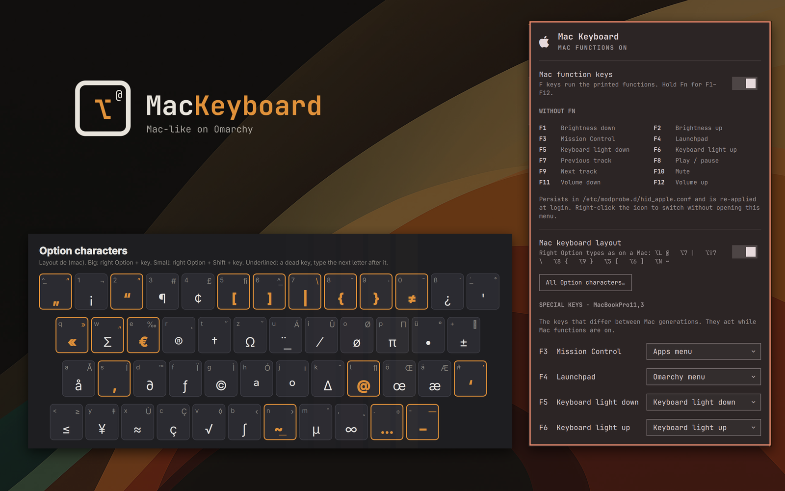
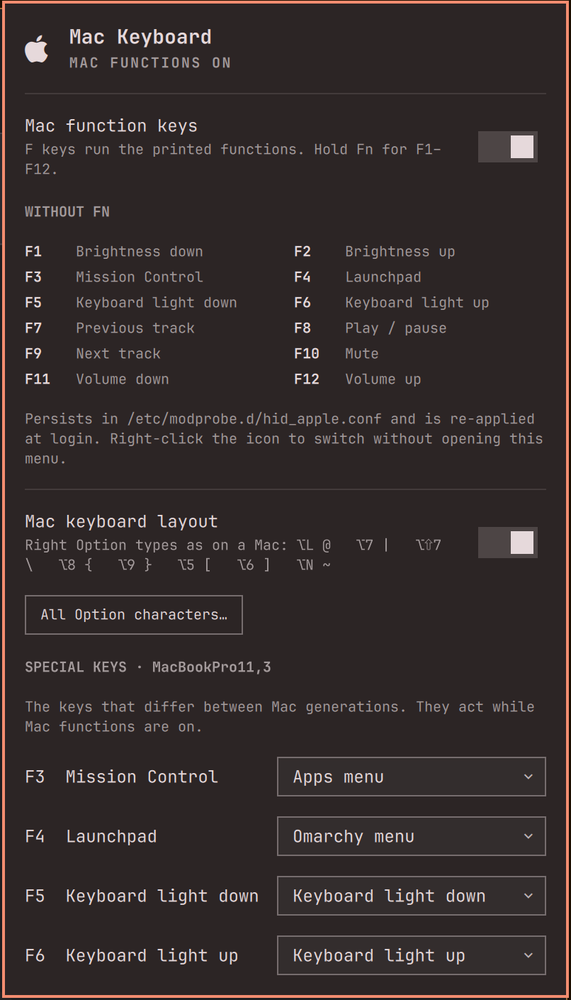
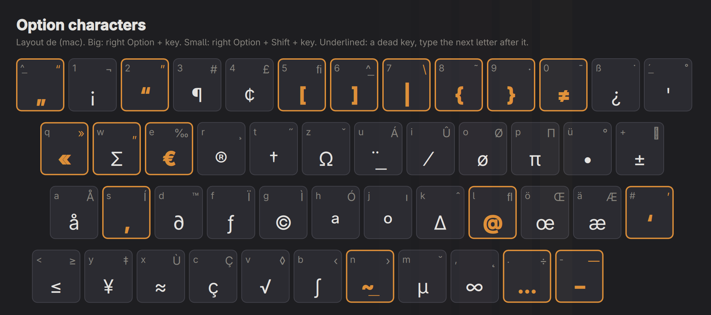

<div align="center">
  <picture>
    <source media="(prefers-color-scheme: dark)" srcset="docs/images/logo-dark.svg">
    
  </picture>
  <p><strong>A MacBook keyboard that types the way it does on a Mac.</strong></p>
  <p>
    
    
    
    <a href="LICENSE"></a>
  </p>
</div>

# Mac Keyboard for Omarchy

After years on a Mac your fingers know where `@`, `|` and `{` are: on the Option key. Mac Keyboard
brings that back on Omarchy, together with the function row the way macOS has it.

- **Mac layout.** The right Option key types the Mac characters of *your* layout; on a German Mac
  layout Option+L is `@`, Option+7 is `|`, Option+Shift+7 is `\`, Option+8 and 9 are `{` and `}`,
  Option+5 and 6 are `[` and `]`. It keeps your layout (German, US, French ...) and only switches on its xkb `mac` variant. The
  left Alt stays Alt for Hyprland's shortcuts. **All Option characters…** in the menu opens a cheat
  sheet of your whole keyboard, read from your layout, not typed in by hand.
- **Function row.** The keys send their printed functions (brightness, volume, media) without Fn,
  and the bar icon switches the row back to F1-F12 when you need them. This only flips the kernel's
  `hid_apple fnmode`; nothing is remapped, every key sends what is printed on it.
- **Special keys.** The few keys that differ between Mac generations (Mission Control, Launchpad or
  Spotlight, keyboard light, Dictation, Do Not Disturb) keep sensible defaults and can be set in the
  menu: Omarchy menu, apps menu, Do Not Disturb, keyboard light, microphone mute, screenshot, capture
  menu, dictation (voxtype), nothing, or a command of your own.



<table>
  <tr>
    <td width="30%"></td>
    <td></td>
  </tr>
  <tr>
    <td align="center">The menu</td>
    <td align="center">All Option characters: the cheat sheet, read from your layout</td>
  </tr>
</table>

## Bar icon and menu

| Icon | Meaning |
| --- | --- |
| Apple logo, bright | Mac functions on: the function row sends brightness, volume and media without Fn. Hold Fn for F1-F12 |
| Apple logo, dimmed | Mac functions off (F1-F12), or the Fn switch is not set up or not available on this machine |

- **Left click** opens the menu: the Fn switch with a legend of your Mac's function row, the Mac
  layout switch, the cheat sheet and the special keys.
- **Right click** switches the Fn mode directly.

The icon shows on every machine: the layout switch also works without an Apple keyboard, for example
in a virtual machine on a Mac, where the host handles the function row. The Fn part of the menu says
when it is not available or needs its one-time setup.

## Special keys

The rest of the row is the same on every Mac with real F keys. Touch Bar Macs have no F row and are
not covered. The menu lists the keys of the Mac it runs on (from the firmware's model name) and
everything when it does not recognise the machine.

| Key | Intel Macs (e.g. MacBook Pro 11,3) | Apple Silicon (e.g. MacBook Pro 18,3) | Default |
| --- | --- | --- | --- |
| F3 | Mission Control `XF86LaunchA` | Mission Control `XF86LaunchA` | Apps menu |
| F4 | Launchpad `XF86LaunchB` | Spotlight `XF86Search` | Omarchy menu |
| F5 | Keyboard light down `XF86KbdBrightnessDown` | Dictation `XF86AudioMicMute` | Omarchy's own action |
| F6 | Keyboard light up `XF86KbdBrightnessUp` | Do Not Disturb `XF86Sleep` | Omarchy's own / Do Not Disturb |

F6 on Apple Silicon is `KEY_SLEEP` to the kernel. While printed-keys mode is active the plugin holds
a logind `handle-suspend-key` inhibitor so the key silences notifications instead of suspending the
machine. The inhibitor is released as soon as you switch to F1-F12 or the shell exits.

## Install

```sh
omarchy plugin add https://github.com/2strange/omarchy-mackeyboard.git --enable
```

The layout switch and the special keys work right away. The Fn switch needs a one-time setup: click
**Set up** in the menu (or run the script) and enter your password once:

```sh
~/.config/omarchy/plugins/io.github.2strange.mackeyboard/scripts/setup
```

Setup does three things, all reversible:

1. Installs a root-owned helper at `/usr/local/libexec/omarchy-mac-fnmode` and
   a sudoers rule in `/etc/sudoers.d/omarchy-mac-fnmode` that lets your user
   run exactly `omarchy-mac-fnmode 1` and `omarchy-mac-fnmode 2` without a
   password. Nothing else is granted; the helper accepts no other arguments.
2. Switches `hid_apple` to `fnmode=1` and persists it in
   `/etc/modprobe.d/hid_apple.conf` (the same file Omarchy's Apple install
   writes).
3. Appends one clearly marked block to `~/.config/hypr/bindings.lua` that
   loads `hypr/bindings.lua` from the plugin folder (skipped if the menu already
   added it). Nothing already in that file is modified.

**Coming from Mac Fn keys** (`io.github.2strange.mac-fnkeys`) or the upstream
[MacBook Function Keys](https://github.com/alnandr/omarchy-macbook-fn-keys) plugin: do not keep both.
They install the same helper at the same path, so the Fn switch keeps working, but both bind the same
keys. Delete the old plugin's marked block from `~/.config/hypr/bindings.lua` by hand and remove the
old plugin with `omarchy plugin remove`. **Do not run the old plugin's `scripts/uninstall`**: it
removes the shared helper and sudoers rule (run this plugin's `scripts/setup` again if you did). Until
the old block is gone, the menu refuses to change the layout or the keys and says why.

## How the Fn switch works


- `Service.qml` reads `/sys/module/hid_apple/parameters/fnmode` directly (no
  privileges needed), holds the F6 suspend inhibitor, and runs the helper
  through `/usr/bin/sudo -n` when you click. Every child process is started by
  absolute path with the inherited environment cleared, output is bounded to
  one line, the helper call has a 10 s deadline (SIGTERM, then SIGKILL), and
  all children are torn down when the plugin unloads.
- `BarWidget.qml` paints the mode and forwards clicks, `Panel.qml` is the menu.
  `keyboard-config.py` handles the layout switch and the special keys (see below).
  Both read the state from the service through `bar.shell.serviceFor()`, so all
  monitors show the same state.
- On every shell start the service reads `/etc/modprobe.d/hid_apple.conf` and
  re-applies that mode, because an initramfs that loads `hid_apple` (mkinitcpio
  `keyboard` + `modconf` hooks) carries a stale copy of that file.
- `scripts/omarchy-mac-fnmode` is the only code that ever runs as root after
  setup. Read it before running setup; it is under 60 lines.

### Privilege boundary during setup

Root never opens a file under the user-writable plugin checkout. `scripts/setup`
reads `scripts/setup-root` into memory and passes it to root as a string via
`sudo /usr/bin/bash -c`, and streams the helper's bytes to root on stdin.
`setup-root` carries the helper's SHA-256 and refuses to install anything that
does not match, verifies the installed file again, validates the generated
sudoers rule with `visudo -c`, and stages everything in a root-only
`mktemp -d` under `/run`. Swapping either file after the password prompt
cannot change what root installs. Uninstall uses the same by-value pattern with
a fixed string.

## The layout switch and the special keys

- The menu calls `keyboard-config.py`, which writes `~/.config/hypr/mackeyboard.lua` from a JSON
  state line at its top, reloads Hyprland and checks `hyprctl configerrors`. If Hyprland reports a new
  error, every file it touched is put back and the menu says so.
- The layout switch sets `kb_variant` to `mac` for each of your layouts that has a Mac variant in
  `/usr/share/X11/xkb/symbols`; the others keep theirs. Switching it off restores the variants you had.
  Until you first use the menu, your own `kb_variant` stays in charge; after that the plugin sets it,
  remembering your own variant per layout. When you change `kb_layout`, the menu rewrites it on its
  next opening. Only variants named exactly `mac` count: Swiss `ch(de_mac)` / `ch(fr_mac)` are not
  switched (set them in `input.lua` yourself).
- The examples next to the switch and the cheat sheet come from your active layout: on a US Mac layout
  `@` stays on Shift+2, so there are fewer Option examples.
- A special key bound by Omarchy (keyboard light, microphone mute) keeps Omarchy's binding unless you
  pick something else, then the plugin unbinds it first. Your own command is stored as one line and
  escaped into the Lua file.
- The cheat sheet (`cheatsheet/`, run with `qs -n -p`, one window at a time) gets its characters
  from libxkbcommon for the layout you type with, so it matches what the keys type.

```sh
python3 ~/.config/omarchy/plugins/io.github.2strange.mackeyboard/keyboard-config.py get
python3 ~/.config/omarchy/plugins/io.github.2strange.mackeyboard/keyboard-config.py set mac_layout=true
python3 ~/.config/omarchy/plugins/io.github.2strange.mackeyboard/keyboard-config.py set key.XF86LaunchA=menu
```

## Dependencies

Everything used is part of a standard Omarchy install: `sudo`, `visudo`,
`systemd-inhibit`, `hyprctl`, `python3`, `libxkbcommon` (for the cheat sheet), `qs` (Quickshell, for
the cheat sheet window) and the JetBrainsMono Nerd Font for the bar glyphs. No packages are installed
and nothing is downloaded.

## Remove

```sh
~/.config/omarchy/plugins/io.github.2strange.mackeyboard/scripts/uninstall
omarchy plugin remove io.github.2strange.mackeyboard
```

Uninstall restores Omarchy's Apple default (`fnmode=2`), removes the helper
and sudoers rule, `~/.config/hypr/mackeyboard.lua` and the marked block from `bindings.lua`.

Used only the layout switch and the keys (no Fn setup)? Then `keyboard-config.py reset`, delete the
marked block in `bindings.lua`, and `omarchy plugin remove` are enough, no password needed.

## Credits

The Fn switch, its root helper and the privilege boundary are the work of Alan Garcia
([MacBook Function Keys](https://github.com/alnandr/omarchy-macbook-fn-keys), MIT), unchanged here.
The layout switch, the cheat sheet, the special keys and the menu are by 2strange. See also
[MagicMouse](https://github.com/2strange/omarchy-magicmouse) and
[Mac Trackpad](https://github.com/2strange/omarchy-mactrackpad).

## License

MIT. See [LICENSE](LICENSE). Original work by Alan Garcia, changes by 2strange.
